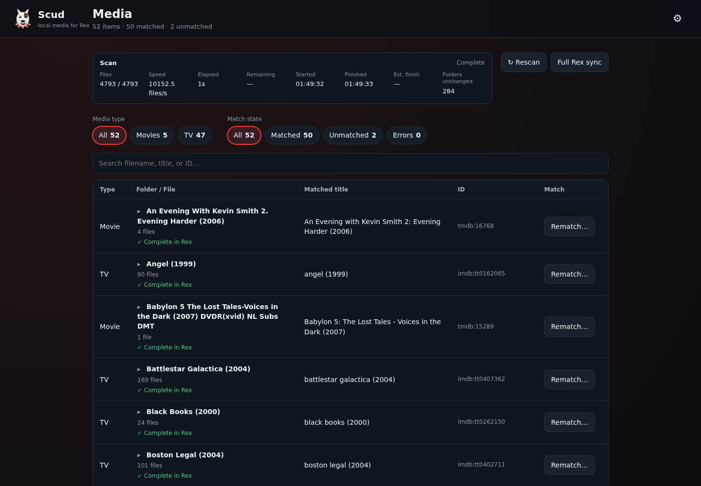

<p align="center"></p>

# Scud

**Local media for Rex.** Scud scans your movie and TV folders, identifies the files, and makes them available in [Rex](https://github.com/debridmediamanager/rex). Watch them using your usual Rex-compatible client.

Scud works with local disks, mounted network shares, and any other folder the Scud server can read. It uses TMDB to identify movies and TV shows.

## Features

- Add and edit multiple movie and TV folders in the wizard or Settings.
- Match titles with TMDB and correct whole folders or individual episodes.
- Browse folders, seasons, episodes and movie versions; filter by media type and match state.
- Skip matching and probing for unchanged folders using file names, sizes and modification times.
- Cache FFprobe streams, formats and chapters, and publish recognised bonus videos as Rex extras.
- Deliver changes through a persistent queue with retry backoff, independent of scanning.
- Recover lost snapshot sessions and send a full snapshot at startup and on schedule.
- Check Rex and TMDB compatibility at startup, with failures visible in the interface and logs.
- Choose a log level in Settings; the default is INFO.

Unmatched media stays in Scud. Bonus videos need a matched movie or episode in the same media folder before Rex can attach them to that title. Numbered TV specials remain episodes.

Rex handles playback and metadata. Scud serves the original files without transcoding. Archive and provider extraction are outside Scud’s scope; use ordinary video files in readable local folders.

## Requirements

- Linux with systemd for the installer.
- Python 3.10 or later.
- FFmpeg and FFprobe. The installer installs FFmpeg on systems with `apt` if FFprobe is missing.
- A Rex server reachable from Scud over a local or private network, such as Tailscale.
- Access to Rex’s library API to create or reuse your media libraries.
- A TMDB API key and internet access for automatic matching and suggestions.

## Install

Extract the archive, open its folder, and run:

```bash
cd scud
sudo ./install.sh
```

The installer copies Scud to `/opt/scud`, installs its Python dependencies, and starts the `scud` systemd service. Existing configuration, matches and cached media data are preserved when you run it again.

Open the URL printed by the installer. The default port is `8788`. If that port is occupied, the installer asks you to choose another one.

For an unattended installation, specify a port:

```bash
sudo SCUD_PORT=8789 ./install.sh
```

If the selected port is unavailable and no input is provided, installation stops with an error.

The interface has no user authentication. Run Scud on a trusted network, or protect it with an authenticated reverse proxy. Deleting local files from Rex is disabled by default; it can be enabled explicitly in Settings.

## Set up your media

The first visit opens the setup wizard:

1. Enter your Rex server's URL, including its port, and click **Test Rex**. Enter your TMDB API key and click **Test TMDB**. The source name identifies this Scud installation in Rex; `scud` works for a single installation.
2. Add your folders. For each one, choose **Media type**, enter its **Folder path**, and give it a **Library name**. Paths refer to the Scud server. Scud creates or reuses a Rex library with that name and media type.
3. Set how often Scud checks the folders and sends a full sync. If you use a custom FFmpeg installation, enter its path and click **Test FFmpeg**.
4. Review the settings and click **Save & start Scud**.

Scud runs startup compatibility checks, scans the folders, and queues their media for Rex. Unchanged folders skip matching and probing. API check failures appear in the log and interface; Settings → Compatibility shows the results and last tested Rex commit. Open **Media** to browse your folders and their files. Use the folder’s **Match…** button to identify a show or movie folder, including its subfolders and files added later. For an incorrect or missing match, click **Match…** and enter an IMDb, TMDB, or TVDB ID.

Use the gear button to open **Settings** later.

## Configuration

The wizard and Settings page save to `/opt/scud/config.yml`. You can also edit this file directly and restart Scud.

```yaml
scud: v1
host: 0.0.0.0
port: 8788
source_url: ""
rex_url: http://rex:32400
rex_source: scud
rex_snapshot_every_hours: 6
poll_every_secs: 60
ffmpeg_path: ""
tmdb_api_key: ""
libraries:
  - id: movies
    type: movie
    name: Movies
    path: /mnt/media/movies
  - id: tv
    type: show
    name: TV
    path: /mnt/media/tv
```

Replace the example Rex URL and folder paths with your own. See [Configuration](docs/config.md) for all options.

## Data and updates

Back up these paths:

```text
/opt/scud/config.yml
/opt/scud/data/scud.db
```

The database stores discovered files, matches, media details, and sync history. Run the installer again to update Scud while preserving these files.

Service commands:

```bash
systemctl status scud
systemctl restart scud
journalctl -u scud -f
```

To remove the service:

```bash
sudo bash /opt/scud/uninstall.sh
```

The uninstaller keeps `/opt/scud`, including your configuration and database.

## Screenshots



| Setup | Browse and match | Settings |
| --- | --- | --- |
| [Connections](screenshots/01-setup-connections.png) | [Movies](screenshots/07-movies.png) | [Multiple folders](screenshots/04-settings-libraries.png) |
| [Library folders](screenshots/02-setup-libraries.png) | [TMDB title suggestions](screenshots/08-match-title.png) | [Scanning and logging](screenshots/05-settings-scanning.png) |
| [Scanning options](screenshots/03-setup-scanning.png) | [Seasons and episodes](screenshots/09-episodes.png) | [API compatibility](screenshots/12-compatibility.png) |
| | [Episode picker](screenshots/10-match-episode.png) | [Mobile view](screenshots/13-mobile.png) |
| | [Unmatched folders](screenshots/11-unmatched.png) | |

Screenshots use example server addresses and folder paths.

## Documentation

- [Configuration](docs/config.md)
- [Matching](docs/matching.md)
- [Troubleshooting](docs/troubleshooting.md)
- [Rex integration](docs/rex.md)
- [Rex and Zurg compatibility](docs/zurg-parity.md)
- [Source references and attribution](NOTICE.md)
- [Architecture](docs/architecture.md)

## Development

```bash
python3 -m venv .venv
. .venv/bin/activate
pip install -r requirements.txt pytest
cp config.example.yml config.yml
python -m scud
pytest -q
```

## License

Scud is provided under the MIT License. Rex and Zurg are separate projects with their own licenses.

<!-- rex-compat-start -->
Last live API compatibility test: Rex commit `b534e44289ef2982f5ede06fd51e62d47a2e0d95` (2026-10-24T23:03:00Z).
<!-- rex-compat-end -->
